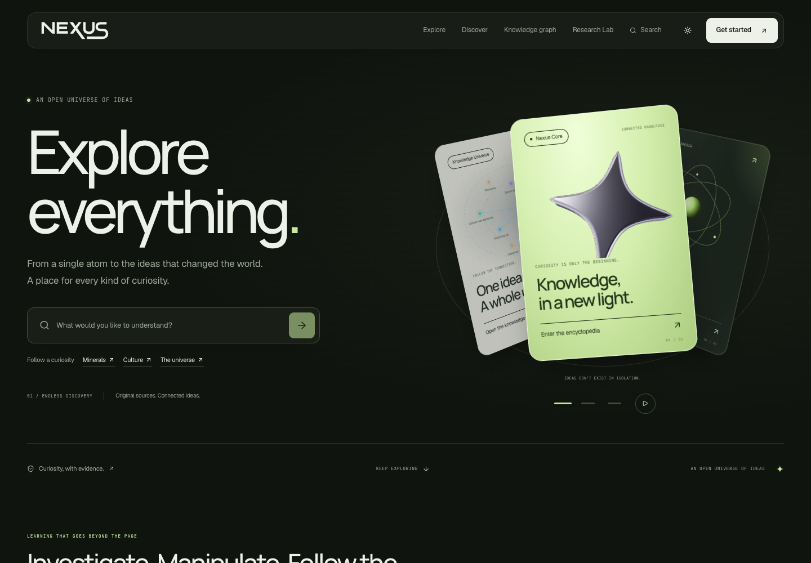
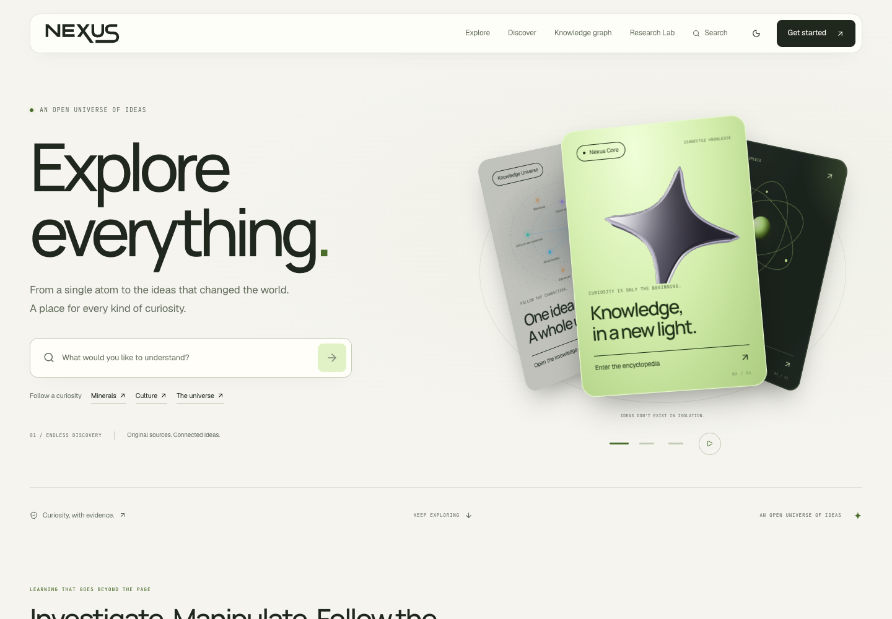
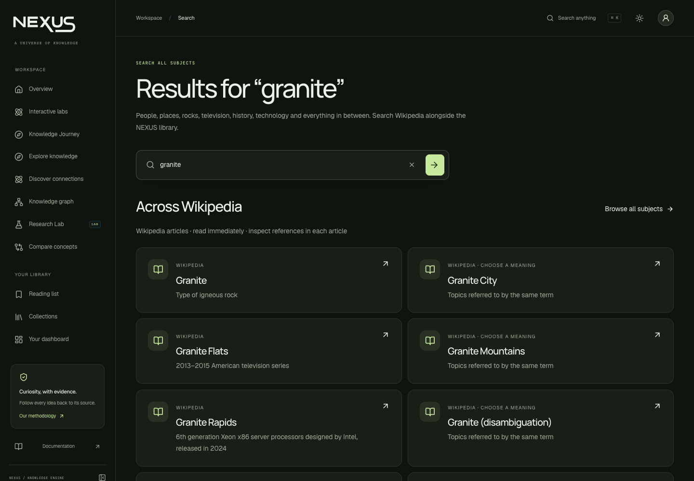
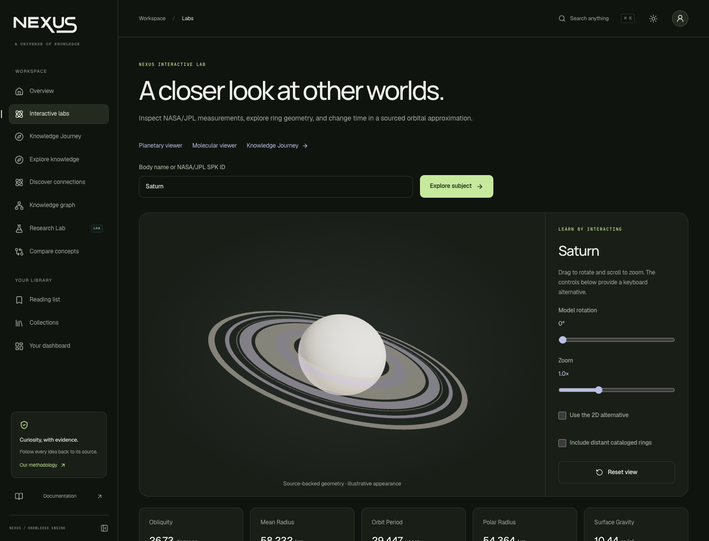
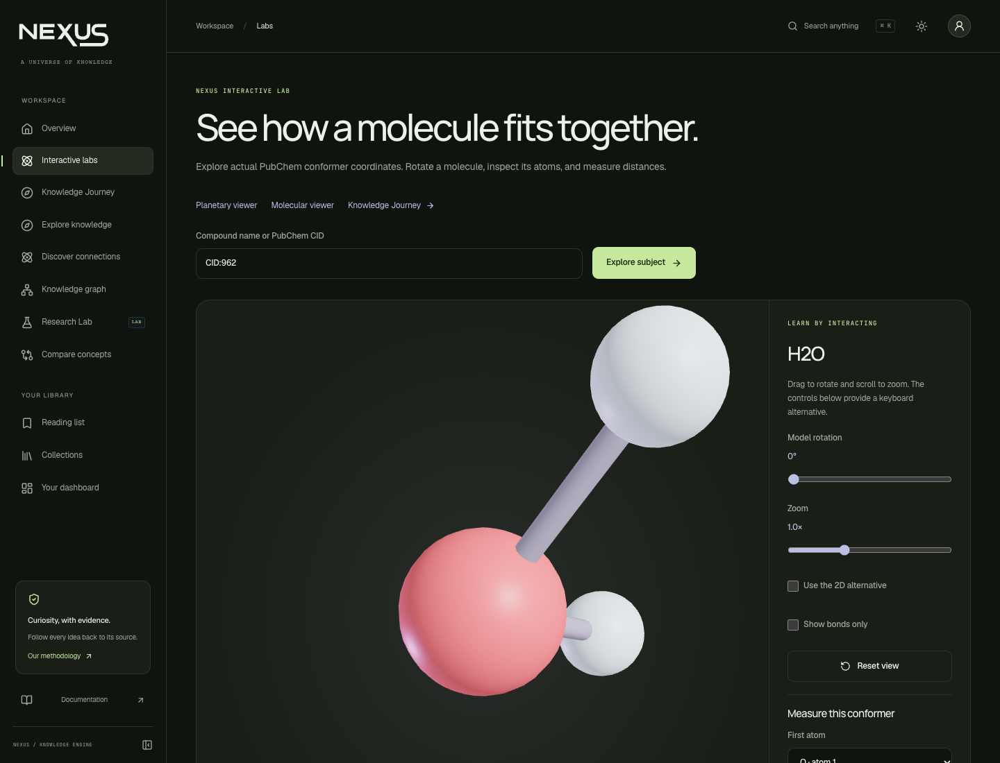
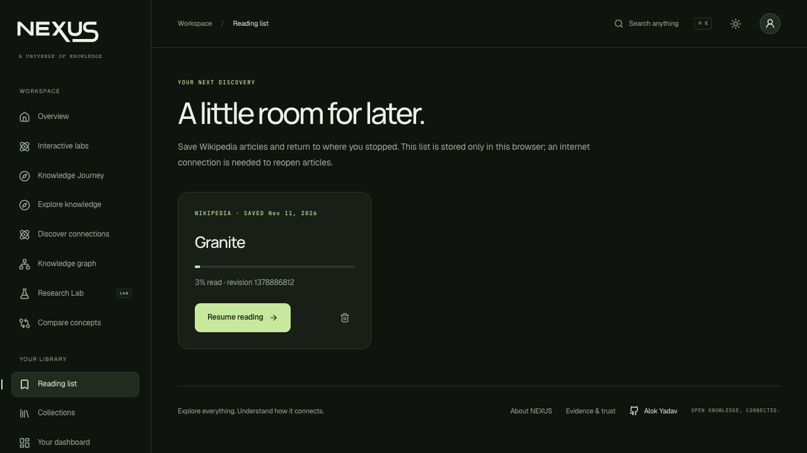
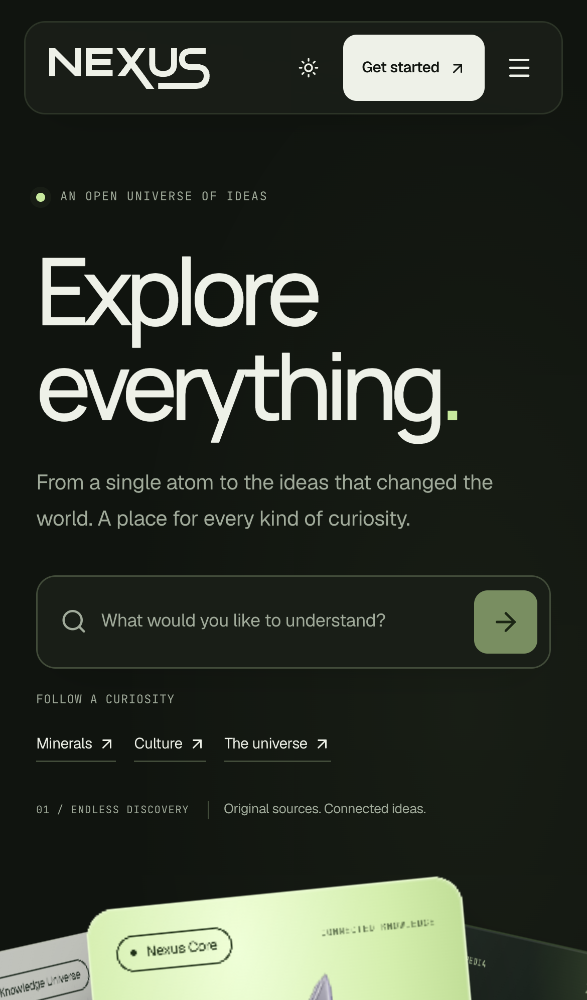
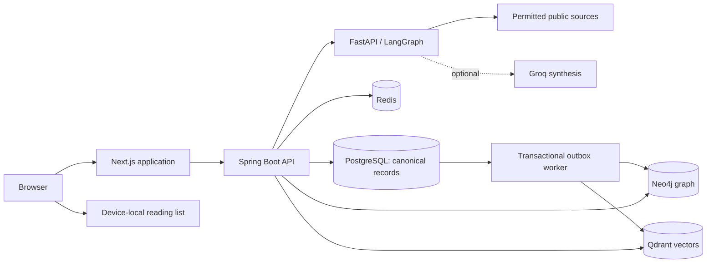
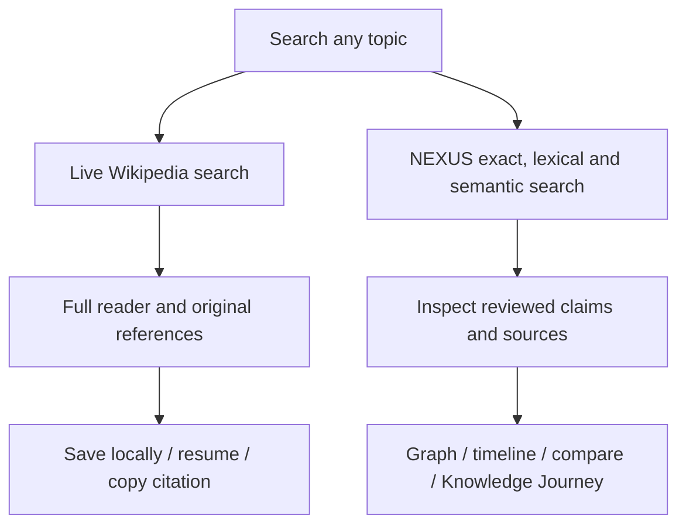
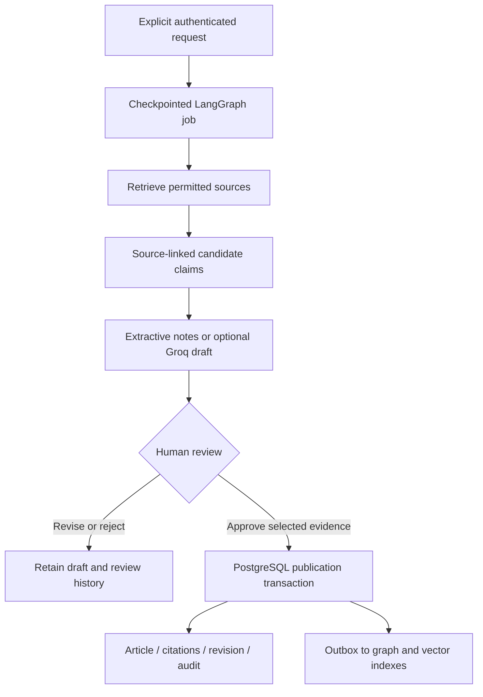

<p align="center">
  <picture>
    <source media="(prefers-color-scheme: dark)" srcset="docs/images/wordmark-dark.svg">
    
  </picture>
</p>
<h3 align="center">Explore everything. Understand how it connects.</h3>
<p align="center">An evidence-first encyclopedia with universal topic search, connected knowledge, interactive science and human-reviewed AI research.</p>
<p align="center">
  <a href="https://github.com/Alok-Yadav25/Nexus/actions/workflows/ci.yml"></a>
  <a href="LICENSE"></a>
  
  
  
  
</p>
<p align="center"><a href="#quick-start">Quick start</a> · <a href="#screenshots">Screenshots</a> · <a href="#tech-stack">Tech stack</a> · <a href="#workflow">Workflow</a> · <a href="docs/API.md">API docs</a></p>



## What you can do

| Experience | Working capabilities |
| --- | --- |
| Search broadly | Live English Wikipedia search across unrelated subjects, pagination, category browsing, and matching articles from the NEXUS library. |
| Read with context | Full Wikipedia reader with references, revision provenance, adjustable text size, citation copying and browser-local save/resume. |
| Inspect evidence | Reviewed NEXUS claims expose sources, verification, conflicting evidence and freshness. |
| Follow connections | Explore 2D/3D graphs, sourced discovery paths, comparisons, timelines and saved Knowledge Journeys. |
| Learn by interacting | Manipulate NASA/JPL/PDS planetary models and measure real PubChem molecular conformers, with usable 2D alternatives. |
| Research deliberately | Explicit research requests run through checkpointed workflows, source-linked drafts and human review. Groq synthesis is optional. |
| Organize knowledge | Accounts, saved canonical articles and private collections persist in PostgreSQL. |

**Trust boundary:** Wikipedia content and research candidates are not automatically NEXUS-verified. Publication requires an authorized human review. The eight attributed starter articles form a small reviewed library; they do not represent the whole of Wikipedia.

## Screenshots

Actual application captures in desktop and mobile browsers, including both color themes.

<table>
<tr><td><br><b>Light theme</b></td><td><br><b>Universal topic search</b></td></tr>
<tr><td><br><b>Planetary viewer</b></td><td><br><b>Molecular viewer</b></td></tr>
</table>

<details>
<summary>Reading list and mobile experience</summary>




</details>

[Image and content credits](docs/images/README.md) · [Design notes](docs/UI_DESIGN.md)

## Tech stack

| Layer | Technologies | Responsibility |
| --- | --- | --- |
| Web application | Next.js 16, React 19, TypeScript | Routing, rendering, metadata and responsive interfaces |
| State and fetching | TanStack Query, Zustand | API caching, mutations and theme state |
| Interaction | CSS Modules, Motion, Three.js, React Three Fiber, React Flow | Accessible motion, scientific models and graphs |
| Core API | Java 21, Spring Boot 3.5, Spring Security, Flyway | Authentication, articles, evidence, review and transactions |
| Research service | Python 3.12, FastAPI, LangGraph, Pydantic, BeautifulSoup | Source retrieval, checkpointed research and model adapters |
| Optional inference | Groq | Source-constrained synthesis with claim-ID validation |
| Canonical database | PostgreSQL 17 | Articles, users, claims, revisions, collections and outbox |
| Graph index | Neo4j 5 | Rebuildable relationship projection |
| Vector index | Qdrant 1.16, FastEmbed / BGE-small-en-v1.5 | Real semantic embeddings and retrieval |
| Cache | Redis 8 | Autocomplete caching, rate counters and coordination |
| Quality and delivery | Maven, pytest, Vitest, Playwright, Docker Compose, GitHub Actions | Integration tests, browser coverage and reproducible services |

## Workflow

### System architecture



PostgreSQL owns publication state. Graph and vector indexes are rebuildable projections with explicit availability and indexing status. Missing indexes do not produce fabricated results.

### Discovery and reading



### Research and publication



Research never starts automatically because a search returned no match. Retrieved claims remain unverified until assessed; similar text is not independent corroboration.

## Quick start

Prerequisites: Docker Engine/Desktop with Compose v2, Python 3, approximately 8 GB available RAM and disk space for images and a small embedding model.

```sh
git clone https://github.com/Alok-Yadav25/Nexus.git
cd Nexus
python3 infrastructure/scripts/init_env.py
docker compose up --build --wait --wait-timeout 600
```

Open **http://localhost:3000**.

The initializer creates a private `.env` with random secrets and mode `0600`, retaining an existing environment. Bootstrap administrator credentials are in that file. New registrations receive reader permissions. Never commit `.env`.

The first semantic indexing pass downloads the open BGE-small English model. Indexing remains pending or failed until the real model and destination are available; no random or hash-based vectors substitute for embeddings.

| Local service | URL |
| --- | --- |
| Application | http://localhost:3000 |
| Core API health | http://localhost:8080/actuator/health |
| API documentation | http://localhost:8080/swagger-ui/index.html |
| Research service health | http://localhost:8000/health |
| Neo4j browser | http://localhost:7474 |

Published service ports bind to loopback. See [deployment and backups](docs/DEPLOYMENT.md) for persistent storage, private services and TLS setup before hosting publicly.

### Optional Groq configuration

Set these variables in the root `.env`:

```dotenv
GROQ_API_KEY=your_server_side_groq_key
GROQ_MODEL=openai/gpt-oss-20b
GROQ_DAILY_REQUEST_BUDGET=100
```

`AI_SERVICE_TOKEN` is a separate internal service credential. Keep provider keys server-side and out of `NEXT_PUBLIC_*` variables. Set `NEXUS_RESEARCH_CONTACT` to a real project contact for source-provider requests. Check `.env.example` for supported settings.

After changing the AI environment in Compose:

```sh
docker compose up -d --no-deps --force-recreate ai
```

Wikipedia search and extractive research work without a Groq key. Model output still requires evidence validation and human review.

### Native development

Install Node.js 22, Java 21+ and Python 3.12. Maven Wrapper is included.

```sh
cd frontend
npm ci
cd ../ai-service
python3 -m venv .venv
.venv/bin/pip install -r requirements.lock.txt
cd ..
./infrastructure/scripts/dev.sh
```

The launcher starts the applications and real PostgreSQL, retaining development data in ignored `data/dev-postgres`. Stop with Ctrl+C. Set `NEXUS_DEV_DATA_DIR` to choose another directory. Without optional index services, availability is reported and canonical SQL traversal remains available.

The `--full` native launcher requires separately prepared tools in ignored `.tools`; those binaries are not distributed in this repository. Docker Compose is the portable full-stack setup.

## Verification

```sh
./backend/mvnw -f backend/pom.xml verify -B
cd ai-service
.venv/bin/python -m pytest -q
cd ../frontend
npm test
npm run build
# With the complete application running:
npx playwright install chromium
npm run test:e2e
```

Playwright covers desktop and mobile, both themes, navigation, real API persistence, evidence, scientific interactions and reading workflows. Set `PLAYWRIGHT_CHROME_PATH` to use an installed Chrome, or `E2E_BASE_URL` to select another local test server. Live provider tests require internet access.

[Verification report](docs/TEST_RESULTS.md) records local results and limitations. GitHub Actions separately runs Java integration tests, Python tests, frontend tests/build and a cold Compose browser job on Linux. The workflow badge above reflects its actual status; configuration alone is not proof of a successful run.

## Repository map

```text
frontend/          Next.js application, shared UI and browser tests
backend/           Spring Boot API, migrations and integration tests
ai-service/        FastAPI research, source adapters and scientific data
infrastructure/    Development scripts, graph schema and seed attribution
docs/              Architecture, APIs, audits, screenshots and operations
.github/workflows/ Continuous verification
```

## Current boundaries and roadmap

- Universal topic coverage currently comes from **English Wikipedia**, rather than an unrestricted whole-web crawler. The reviewed NEXUS graph is a separate, smaller collection.
- Wikipedia reading-list entries and progress are device-local. Account collections for canonical NEXUS articles are server-persisted; cross-device Wikipedia reading sync and offline article packs remain future work.
- Research produces source-linked candidates, not automatic truth. Independent corroboration, automatic graph-triple extraction and licensed image selection remain outstanding.
- Account recovery, email verification, a grounded conversational “Ask NEXUS” interface, richer freshness review and additional subject-specific viewers are useful next milestones.
- Multi-replica session and inference-budget coordination, operational monitoring, production load testing and deployment-specific backup/restore verification require further work.

See the [implementation matrix](docs/NEXUS3_IMPLEMENTATION.md) and [site audit](docs/SITE_AUDIT.md) for tested functionality, fixes and remaining scope. This repository is a working application under active development; it does not claim every feature in the original engineering brief is complete.

## Documentation

[Architecture](docs/ARCHITECTURE.md) · [REST API](docs/API.md) · [Database](docs/DATABASE.md) · [Research pipeline](docs/AI_PIPELINE.md) · [Graph schema](docs/GRAPH_SCHEMA.md) · [Scientific assumptions](docs/SCIENTIFIC_MODELS.md) · [Security](docs/SECURITY.md) · [Deployment](docs/DEPLOYMENT.md)

## License and credits

Application code is available under the [MIT License](LICENSE), copyright © 2026 Alok Yadav. Third-party text, scientific data, fonts and branding retain their respective rights and attribution requirements. See [seed attribution](infrastructure/seeds/attribution.json), [image credits](docs/images/README.md) and [font licenses](frontend/public/licenses).

Built by **[Alok Yadav](https://github.com/Alok-Yadav25)**.
