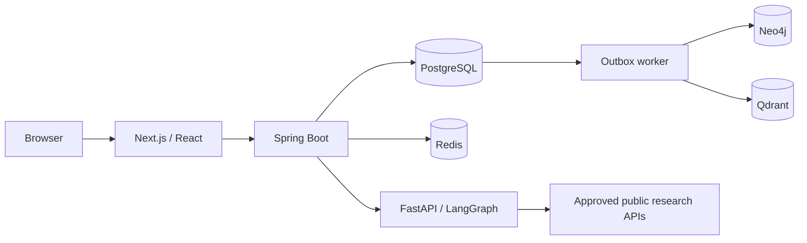

# NEXUS architecture

Next.js App Router → Spring Boot modular monolith → PostgreSQL (canonical).
Spring calls the separate FastAPI AI service over authenticated HTTP. Redis provides advisory job queues, bounded event streams, and autocomplete caching; PostgreSQL leases remain the correctness boundary when Redis is unavailable. A transactional PostgreSQL outbox projects approved content into Neo4j and Qdrant. Python never writes application records or publishes articles.

## Validated decisions

- Java 21 target; Spring Boot 3.5.16 supports the installed Java 22 runtime (https://docs.spring.io/spring-boot/3.5/system-requirements.html).
- Next.js 16, React 19, Node 22. See https://nextjs.org/docs/app/getting-started/installation.
- Public research APIs and lightweight embeddings require no paid inference provider. Extractive drafts must be labeled, evidence linked, and reviewed. Optional server-side Groq synthesis validates claim IDs and still requires human review.
- Do not automatically research unknown search strings. Research is an explicit authenticated action.
- Separate evidence status from ontology and publication state. Similar source text is not independent verification.
- No invented metrics or path edges. Empty data and unavailable indexes are visible states.
- Hosting needs persistent processes and storage. Docker on a self-hosted machine is the complete free development path; hosted free quotas are capacity constraints, not production guarantees.

## Boundaries

Auth; articles/entities/evidence; search/autocomplete; graph/discovery; research/review; revisions; outbox/indexing; quality/analytics. Controllers validate and delegate. PostgreSQL transactions own publication and outbox creation. Index success is tracked per destination.

## Implementation order

1. Running services, migrations, health checks.
2. Source-backed article/evidence CRUD and frontend.
3. Radix autocomplete, full text, vector retrieval, RRF.
4. Graph projections, paths, comparison, timeline.
5. Checkpointed research and review.
6. Revisions, quality, collections, administration.
7. Security, integration/E2E verification, documentation and deployment.
